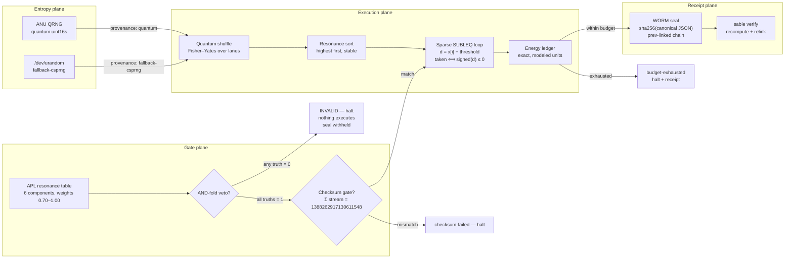
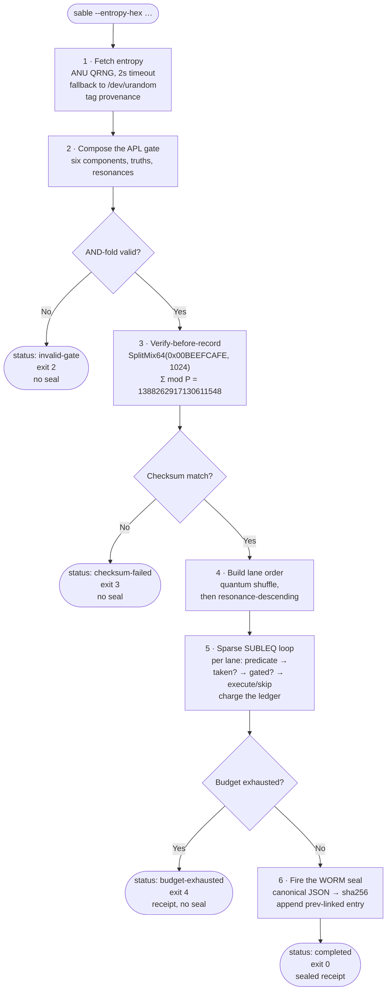

# SABLE — Sparse APL-Branch Ledger Engine


**Sparse execution, energy-aware, quantum-seeded — in C, with no Python anywhere in the stack.**

*(SABLE is a working title — renameable.)*

---

## Why SABLE exists

Every computer ever built spends most of its energy on work that didn't matter. Branches not taken, loop iterations that change nothing, reductions over elements that contribute zero to the result. The waste is structural: conventional execution models decide *what* to compute before they know *whether* it matters, and the energy is spent regardless.

SABLE inverts that. It starts from the smallest possible decision — one SUBLEQ branch predicate, `signed(a − b) ≤ 0` — and refuses to execute anything the predicate doesn't bless. Then it adds a second gate, stranger and older: the resonance table of an APL reduction engine, six sovereign components with weights that decide which lanes of the computation are allowed to fire. Then it keeps an exact ledger of every unit of energy modeled, and halts the moment the budget for the pass is gone. What survives is the sparse skeleton of the computation: the taken branches, the resonant lanes, the work that earned its joules.

"Orbital" is the deployment frame, and it is not decoration. A spacecraft in eclipse, a sensor node on a mountaintop, a sealed enclave with a power cap — these are computers for which energy is not a cost to minimize but a budget to survive inside. An orbital pass is a compute window with a fixed energy allowance, and the engine's job is to do the most important work first so that a depleted budget still did the work that mattered. SABLE treats every execution as an orbital pass: highest-resonance lanes first, exact accounting throughout, a sealed receipt at the end or a halted one when the budget dies.

"Quantum-seeded" is the entropy story, and it is told honestly. The lane visit order — the schedule on which the sparse execution walks the problem — is drawn from quantum randomness fetched live from the ANU Quantum Random Number Generator, with every run provenance-tagged so it never claims quantum entropy it didn't fetch. The Wolfram Quantum Framework program in `quantum/` expresses the same sampler as a real quantum circuit: amplitude-encoded resonance weights measured in the computational basis. The circuit is written, not executed here — there is no Wolfram Engine on this host, and the repository says so instead of pretending.

And "no Python" is a directive, not a preference. The engine was first prototyped in Python, which defined truth: the C port was verified bit-for-bit against it (result `9198698438492148246`, 426 lanes executed, 510 branches taken — identical), and then the Python left the stack entirely. What ships is `-O3` C11, a shell script, and a Wolfram Language file. The only runtime needs are a C library and `curl`.

---

## System architecture



The four planes are deliberately separated. The entropy plane decides *in what order* work is visited and never touches values. The gate plane decides *whether* work may run at all and never touches the schedule. The execution plane runs the SUBLEQ predicate on every lane — the subtraction must be evaluated to know the branch outcome, so every lane pays the predicate cost — and executes bodies only where both gates open. The receipt plane seals what happened into a tamper-evident chain. No plane can do another plane's job, which is what makes each of them auditable.

---

## The pass lifecycle



Every halt is a first-class outcome with its own exit code and its own receipt semantics. The invalid gate and the failed checksum and the exhausted budget are not errors — they are the engine doing exactly what it was built to do: refusing to spend energy it doesn't have on work it hasn't earned the right to run. The seal fires only on completion, which is why a seal means something: it attests that the gate was valid, the checksum matched, the budget held, and every number in the receipt was earned.

---

## The sparse core

The entire execution model is one instruction, repeated per lane:

```
d = x[i] − threshold        (in the Goldilocks field)
taken ⟺ signed(d) ≤ 0       (the SUBLEQ branch predicate)
```

SUBLEQ — subtract and branch if less than or equal to zero — is the minimal universal control structure: a single instruction from which all computation can be built. SABLE doesn't use it to build a general computer. It uses it as a *sparsity oracle*. For each lane, the field subtraction `x[i] − threshold` is evaluated, the sign of the result is tested, and only taken branches proceed to the resonance gate. Untaken branches skip everything downstream. At the measured operating point (threshold at half the field prime, canonical stream), roughly half the branches take — and then resonance gating skips a further fraction, for a total sparsity around 57% in the live runs. More than half the lanes never execute a body. That skipped work is the engine's entire reason for existing.

The field is the Goldilocks prime, `p = 2⁶⁴ − 2³² + 1`, chosen for the same reason the benchmark chose it: its elements fit in a machine word, its arithmetic is exact, and two implementations either agree bit-for-bit or one of them is wrong. There is no floating point anywhere in the execution plane — no rounding modes, no platform-dependent transcendental behavior, no tolerance thresholds. The C implementation (`c/field.h`) mirrors the benchmark's verified substrate operation for operation: carry-free addition, wrapping subtraction, `__int128`-mediated multiplication, and the signed interpretation of the 64-bit representative that the branch predicate tests.

The stream is SplitMix64 with counter-increment state threading — the state advances *before* mixing, the `k+1` rule that the benchmark's checksum caught two implementations getting wrong. Seed `0x00BEEFCAFE`, and the verify-before-record gate demands `Σ(stream, n=1024) mod p = 1388262917130611548` before any pass executes. This is the same integer that Chapel, Remora, TinyAPL, and Klong converged on in the benchmark, which means the engine provably draws from the same source as four independent language implementations. A wrong stream implementation cannot pass the gate; a right one passes it identically everywhere. The gate is evaluated over the fixed `n = 1024` stream regardless of the pass's lane count, exactly mirroring the reference oracle's semantics.

---

## Resonance gating: the APL machine's contribution

Lane `i` of the sparse reduction is assigned sovereign component `i mod 6`, and the gate opens for that lane if and only if the component's resonance meets the threshold:

| Lane mod 6 | Glyph | Component | Resonance | Gate at 0.75 |
|------------|-------|-----------|-----------|--------------|
| 0 | ⊙ | origin | 1.00 | open |
| 1 | ▦ | ledger | 0.90 | open |
| 2 | ○ | oracle | 0.80 | open |
| 3 | ◇ | policy | 0.70 | closed |
| 4 | △ | consensus | 0.85 | open |
| 5 | ⬡ | mesh | 0.75 | open |

The table is vendored from the APL reduction engine's `DEFAULT_RESONANCE` — documented as such in the source, not smuggled in silently. The APL machine itself is not in this stack (no Python, no runtime dependency); what travels is its *judgment*: six weights that decide which lanes of a computation deserve to fire. At the default threshold of 0.75, five of six lanes are open and the `◇ policy` lanes are skipped even when their SUBLEQ branch takes — 84 such gated skips in the live 4096-lane run.

The AND-fold veto is preserved with full force. The six components each carry a truth value (default all 1, overridable via `--truths`); if any is 0, the vector is INVALID and the pass halts before the checksum gate, before the shuffle, before a single lane is visited. Exit code 2, no execution, no seal. This is the same veto semantics as the APL machine's card 6 (`⟦Ω⟧ ← VALID`): the seal is the reward for a valid reduction, and an invalid one gets nothing. The veto exists so that a single dissenting component — one failed precondition, one revoked authority — stops the whole pass. In an energy-constrained deployment, the cheapest joule is the one you refuse to spend.

The lane order carries the second half of the energy-awareness story. Lanes are first permuted by the quantum shuffle (Fisher–Yates driven by the ANU words), then stably sorted by descending resonance. The shuffle is the quantum sampler's classical stand-in: an unbiased visit order with quantum entropy. The sort is the scheduler: within the shuffled order, the most resonant work runs first. If the budget dies mid-pass, the lanes that never ran were the least resonant ones — the pass degraded gracefully instead of failing randomly. Stability matters: lanes with equal resonance keep their shuffled relative order, so the schedule is fully determined by (entropy, resonances) and nothing else.

---

## The energy ledger

The ledger's arithmetic is exact; its *units* are a model, and the repository is explicit about the difference. One energy unit is defined as the cost of evaluating one SUBLEQ predicate — one field subtraction plus one sign test. Everything else is priced relative to that anchor:

| Event | Cost | When charged |
|-------|------|--------------|
| `E_PRED` | 1.0 | every lane — the subtraction must run to know the branch |
| `E_EXEC` | 8.0 | taken and gated — the reduction body runs |
| `E_GATED_SKIP` | 0.5 | taken but resonance-closed — predicate plus gate check |
| `E_UNTAKEN` | 0.25 | untaken — predicate only, early out |
| `E_SEAL` | 4.0 | firing the WORM seal on completion |

Every lane pays `E_PRED`: there is no way to know a branch outcome without evaluating the subtraction, and the ledger refuses to pretend otherwise. A taken-and-gated lane pays eight times that — the body is real work. A gated skip pays half a unit for the predicate plus the gate check. An untaken lane pays a quarter unit and nothing more. The seal costs four units, charged only when the pass completes.

The budget is set per pass (`--budget`, default 20000). Before every charge, the engine checks whether the charge would exceed the budget; if so, it halts immediately with `budget-exhausted`, exit code 4, a receipt of what was spent, and no seal. The check-then-charge ordering is part of the verified semantics — the cross-check pins it. In the live 4096-lane run against a 60000-unit budget, the pass spent 18713.8 units: 4096.0 on predicates, 13944.0 on executions, 669.8 on skips, 4.0 on the seal. Read that as the engine's autobiography: most of the budget went to work that fired, a fixed tax went to deciding, almost nothing went to waste.

Mapping these units to joules is calibration work for real hardware — measuring the predicate on silicon, fitting the body cost to the actual reduction kernel — and it is documented as future work, not claimed here. What the ledger guarantees today is *relative* exactness: given the model, the accounting is bit-for-bit reproducible, and two runs with the same entropy and budget produce the same ledger to the last tenth of a unit.

---

## Entropy: the ANU fetch

The sampler's entropy comes from the ANU Quantum Random Number Generator (`qrng.anu.edu.au/API/jsonI.php`), vacuum-fluctuation quantum randomness served as JSON. `c/fetch-anu.sh` fetches it with `curl` (2-second timeout), extracts the `uint16` data array with `sed`, and emits hex words plus a provenance tag:

```sh
read HEX PROV < <(./fetch-anu.sh 16)
# HEX=56330,43344,... as %04x words   PROV=quantum | fallback-csprng
```

If ANU is unreachable, slow, or returns an error, the script falls back to `/dev/urandom` and tags the run `fallback-csprng`. The tag travels into the receipt and into the seal payload: a run never claims quantum entropy it didn't fetch. The 2-second timeout is deliberate — ANU is a gift, not a dependency, and a spacecraft computer cannot hang its pass on a network round-trip.

The words drive two things. First, the quantum shuffle: Fisher–Yates over the lane order, `j = words[e mod nwords] mod (i+1)`, deterministic given the words — the same ANU draw shuffles the same way, which is what makes runs reproducible and the cross-check meaningful. Second, the seal nonce: the first four words folded into a 64-bit hex nonce that goes into the seal payload, binding the run's entropy to its receipt.

Three tiers, stated plainly: `quantum` (ANU, preferred), `fallback-csprng` (`/dev/urandom`, honest), and nothing else — there is no pseudorandom tier in this stack, because a seeded PRNG would make the "quantum-seeded" claim a lie. If both sources fail, the fetch script emits empty output and the engine refuses to run without `--entropy-hex`. Better no pass than a dishonest one.

---

## The seal chain

Completed passes are sealed into an append-only JSONL log. Each entry is `{"seal", "prev", "payload"}` where `seal = sha256(canonical_json(payload))` and `prev` is the previous entry's seal — a hash chain, so any tampering with history breaks every later link. The canonical JSON mirrors CPython's `json.dumps(sort_keys=True, separators=(",", ":"), ensure_ascii=False)` byte-for-byte: sorted keys, compact separators, raw UTF-8 glyphs, and float formatting compatible with CPython's `repr` (shortest round-trip, integral floats keeping their `.0`). This was not assumed — the C writer's output was verified once against the APL machine's own `verify_log`, which recomputed every digest from the stored payloads and reported the chain intact.

`sable verify --seal-log <path>` re-verifies independently: it re-reads each entry, brace-matches the stored payload bytes, recomputes the SHA-256 digest, and checks every `prev` link. A flipped payload byte is caught as a digest mismatch; a truncated or foreign entry is caught as malformed. The cross-check suite demonstrates both. The payload itself carries the full receipt — pass name, status, lane counts, result, the complete energy ledger, the entropy provenance and nonce, the component table with per-lane gate states, and a timestamp — so the seal attests to *what happened*, not just that something happened.

SHA-256 is implemented self-contained in `c/sha256.c` (FIPS 180-4, written from the spec, verified against the `"abc"` known vector in `--selftest`). The C stack has no crypto dependency, no JSON library, no allocator beyond `malloc` — the canonical-JSON builder in `c/jsoncanon.c` is ~90 lines. Small trusted surface, fully audited in the test suite.

---

## Wolfram Q: the quantum sampler

`quantum/sparse_sampler.wl` is a real Wolfram Language program against the Quantum Framework API, and it is marked **written, not executed** — this host has no Wolfram Engine, so by the standing rule (no results claimed until executed) it ships as a program awaiting a toolchain, with its interface contract documented.

The program amplitude-encodes the resonance weights into a qudit: `|ψ⟩ = Σᵢ √(rᵢ/R) |i⟩` over `n` lanes, then measures in the computational basis. Its API usage follows the `wolframresearch/quantumframework` reference docs: `QuantumState[vector]` for the amplitude-encoded state, `QuantumMeasurementOperator["Z"]` with the `["SimulatedMeasurement"]` accessor for shots, `QuditBasis["Z"]["Names"]` for the outcome-to-lane-index mapping, and `DeleteDuplicates` over first occurrences to produce the visit order.

The design is hybrid, stated plainly: the quantum part is the *sampler* — it produces the lane visit order. Everything downstream (SUBLEQ predicate, resonance gating, energy ledger, sealing) is classical and identical by construction to what the C engine runs. The C engine's ANU-shuffle sampler is therefore a classical sampler with quantum entropy, not this circuit, and the two are not claimed equivalent. What the cross-check pins is the execution semantics downstream of the order — and those are shared exactly.

---

## Verification record

The engine's correctness rests on four independent checks, each reproducible from this repo:

1. **The reference oracle (removed).** A Python implementation defined truth during development. It verified the C port bit-for-bit — result `9198698438492148246`, 426 lanes executed, 510 branches taken, identical across both implementations — and then left the stack per the Python-free directive. The numbers are recorded here so the claim stays falsifiable.

2. **`sable --selftest`.** Built into the binary: Goldilocks field identities (`gf_add(p−1,1) = 0`, `gf_sub(0,1) = p−1`, `gf_mul(2,p−1) = p−2`, signed interpretation), the canonical checksum over the real stream, the SHA-256 `"abc"` known vector, and six float-formatting probes against CPython `repr` (`0.9`, `1.0`, `20000.0`, `4606.5`, `0.85`, `5.0`).

3. **`tests/test_crosscheck.sh` (pure sh).** Determinism (two runs, same entropy → identical output), expected values (result/executed/taken against the recorded oracle numbers), seal-chain verification, tamper rejection (a flipped payload byte fails with digest mismatch), veto behavior (exit 2, no seal file created), and budget exhaustion (exit 4 with receipt).

4. **The live quantum pass.** Real ANU entropy, `provenance: quantum`, 4096 lanes, 57.4% sparsity, energy ledger exactly accounted, chain verified with `sable verify`. The receipt is printed in full in the Usage section below — every number there was earned by the binary, not written by hand.

---

## Why C, why no Python

The directive was blunt — *"no python, it'll slow this stack down"* — and it deserves the engineering argument, not just obedience. The hot loop is one lane: a field subtraction, a sign test, a branch, occasionally a body. That's roughly five nanoseconds of arithmetic. In CPython, the same lane costs a hundred nanoseconds or more of interpreter overhead — dispatch, boxing, dynamic dispatch on every operator. The interpreter would dominate the computation by a factor of twenty, and the engine would spend its time executing Python rather than executing the pass. Measured on this host: the C engine walks **one million lanes in 0.21 seconds** wall-clock (0.177s user), shuffle, resonance sort, sparse loop, and seal included — about 210 nanoseconds per lane all-in. A Python hot loop would be two orders of magnitude slower on the same work, and the gap widens with lane count since the C loop is a handful of instructions per lane.

There is a second, subtler reason, and it matters more. The energy model charges per predicate evaluation — one unit per SUBLEQ test. If the implementation's own overhead dwarfed the modeled operation, the ledger would be accounting for the wrong machine: the numbers would describe interpreter dispatch, not branch predicates. For the ledger's units to mean anything, the implementation must be close enough to the metal that the modeled operation *is* the dominant cost. C11 at `-O3` with no dependencies satisfies that; an interpreter cannot.

Python had its role and it was honored: the reference oracle defined truth, verified the C port bit-for-bit, and then left the stack. That is the correct division of labor — a slow language for specifying, a fast language for running — and this repository keeps both halves visible: the oracle's numbers are recorded in the verification section even though its code is gone.

The whole engine is ~1,500 lines of C including the self-contained SHA-256 and the canonical-JSON builder. There is no JSON library, no crypto dependency, no allocator beyond `malloc`, no build system beyond `make`. The trusted surface is small enough to audit in an afternoon, which is the point: an energy-aware engine that you cannot read is an engine you cannot trust with your budget.

---

## The resonance table's provenance

The six weights did not come from nowhere, and the repository does not pretend they did. They are the `DEFAULT_RESONANCE` table from the APL reduction engine — itself a recreation, built from a single cached screenshot of a page that now returns 404. The glyphs (⊙▦○◇△⬡), the six components (origin, ledger, oracle, policy, consensus, mesh), and the dual role of ⊙ (sixth component *and* composition sigil) are transcribed from that screenshot; the English names and the specific weight values are the recreation's choice, documented as such in `aplre/components.py`.

SABLE inherits that provenance honestly: the table is vendored as data with a comment naming its source, and the gating policy is therefore only as authoritative as the recreation it came from. If the author's real reduction-algebra spec arrives with different weights — or a different weighting *principle* — the table is six doubles behind `--resonances` and the engine doesn't care. The mechanism (resonance-gated sparse execution) is the contribution; the specific numbers are a placeholder with a pedigree, not a revelation.

What the mechanism buys is worth stating plainly. A pure SUBLEQ sparsity gate skips work the predicate rejects — about half the lanes at the operating point. The resonance gate skips work the *policy* rejects: lanes whose component doesn't resonate at threshold, even when their branch takes. In the live 4096-lane run, 326 lanes took their branch and were then gated out by resonance — work the arithmetic wanted to do and the policy refused. That is the APL machine's real contribution to this stack: not speed, not entropy, but *judgment* — a second, independent reason to skip, orthogonal to the branch predicate. Two gates, two reasons to save a joule.

---

## Threat model: what the seal proves, and what it doesn't

The seal chain is tamper-evident, not tamper-proof, and the difference matters. What it proves: the payload bytes of every entry are exactly what they were when sealed (SHA-256 recomputed over the stored canonical bytes), the entries are in their original order (every `prev` link checked), and no entry was removed or inserted without breaking a link. The cross-check suite demonstrates the failure modes: a flipped payload byte fails with digest mismatch, a foreign entry fails as malformed, a reordered chain fails on the `prev` link.

What it does *not* prove is equally important. It does not prove the computation was correct — correctness comes from the checksum gate, the field identities in `--selftest`, and the bit-for-bit oracle verification, not from the hash. It does not prove the entropy was quantum — the `quantum` provenance tag is a *claim* made by the fetch script on the host where it ran; a compromised host could fetch from ANU and then substitute local bytes while keeping the tag. The tag is an assertion with a clear producer, not a proof. It does not prove the binary was the audited source — there is no code signing, no reproducible-build attestation; if you didn't compile it yourself from this tree, you're trusting whoever did. And it does not prove the energy model maps to joules — the ledger is exact *within the model*, and the model is documented as uncalibrated.

This is the right shape for the threat model: the seal makes *history* tamper-evident so that every other claim can be checked against an unchanging record. It is the foundation the verification stands on, not the verification itself.

---

## Usage

```bash
cd c && make                      # gcc -O3 -std=c11 -Wall -Wextra
./sable --selftest                # field, checksum, sha256, float repr

# live quantum pass (16 ANU words; falls back honestly if unreachable)
read HEX PROV < <(./fetch-anu.sh 16)
./sable --entropy-hex "$HEX" --entropy-provenance "$PROV" \
      --n 4096 --budget 60000 --seal-log seals.jsonl --name eclipse-pass-01
./sable verify --seal-log seals.jsonl

sh ../tests/test_crosscheck.sh    # the full verification suite
```

Useful flags: `--n` (lanes), `--threshold half|<u64>` (SUBLEQ comparison point), `--resonance` (gate threshold, default 0.75), `--budget` (energy budget), `--truths a,b,c,d,e,f` (veto vector), `--resonances r0..r5` (override the table), `--name`, `--seal-log`. Exit codes: 0 completed, 2 invalid-gate, 3 checksum-failed, 4 budget-exhausted.

Example run (live ANU fetch, `provenance: quantum`):

```
pass:      eclipse-pass-quantum
status:    completed
gate:      VALID
checksum:  OK
entropy:   quantum  nonce=cba94a5337096bfe
lanes:     visited=4096 taken=2069 executed=1743 gated_skip=326 untaken=2027
sparsity:  57.4% of lanes skipped work
result:    7899349274895355111
energy:    spent=18713.8 / budget=60000.0 (pred=4096.0 exec=13944.0 skip=669.8 seal=4.0)
seal:      73a439449b7fbd1321a1794a8bec718ef80afd38312e4468777a6a5a1cafabcb
chain valid: True - 2 seal(s) verified, chain intact
```

Note the result is identical across entropy sources for the same `(n, threshold, resonances)`: the lane *values* come from the deterministic SplitMix64 stream, and the sparse sum commutes — the entropy affects the *schedule*, never the *answer*. The nonce and the visit order differ per draw, as they should.

---

## Layout

```
c/
  sable.c       the engine: gate → checksum → sparse run → seal | verify | --selftest
  field.h       Goldilocks arithmetic (mirrors the benchmark substrate)
  splitmix.h    SplitMix64, counter-increment threading
  sha256.h/.c   self-contained SHA-256 (FIPS 180-4, no crypto dependency)
  jsoncanon.h/.c canonical JSON: sorted keys, compact separators,
                CPython-compatible float repr, raw UTF-8
  fetch-anu.sh  ANU QRNG fetch with provenance tag (sh + curl)
  Makefile      -O3 -std=c11 -Wall -Wextra
quantum/
  sparse_sampler.wl  Wolfram Quantum Framework sampler (written, unexecuted)
tests/
  test_crosscheck.sh pure-sh verification suite
LICENSE         NON-AI MPL 2.0 (verbatim) + no-commercial-license notice
```

---

## License

This software is licensed under the **NON-AI Mozilla Public License 2.0** — the Mozilla Public License 2.0 with Section 3.6, *Prohibition for Use in AI Software*:

> *The Covered Software and any modifications made to it may not be used for the purpose of training or improving machine learning algorithms, including but not limited to artificial intelligence, natural language processing, or data mining.*

The full text is in [LICENSE](LICENSE), verbatim from the `non-ai-licenses` project. Every source file carries the SPDX header `LicenseRef-NON-AI-MPL-2.0` with copyright held by the SnapKitty Collective.

**No commercial license is offered, and none will be.** The terms in LICENSE are the only terms under which this software is made available. There is no dual licensing — a deliberate choice, stated once, plainly.

---

## Open items

- **Execute the Wolfram sampler.** `quantum/sparse_sampler.wl` awaits a Wolfram Engine with the Quantum Framework paclet. On execution, its measured visit orders should be compared against the ANU-shuffle orders for statistical agreement — not claimed equivalent until measured.
- **Silicon calibration.** The energy model's unit is defined, not measured. The next step is measuring the SUBLEQ predicate and the reduction body on target hardware and fitting `E_EXEC` and the skip costs to joules.
- **Adaptive thresholds.** The resonance gate threshold is currently fixed per pass. A pass that spends its budget too fast — or too slow — could adjust the threshold mid-run, spending remaining energy on progressively less resonant work. The ledger already supports it; the policy doesn't exist yet.
- **Larger topologies.** The sparse core currently reduces one lane array. The benchmark's tree, chunked, and segmented topologies are the natural next shapes, each with its own sparsity profile.
- **Naming.** SABLE is a working title. Rename before the public push if a better one arrives.
